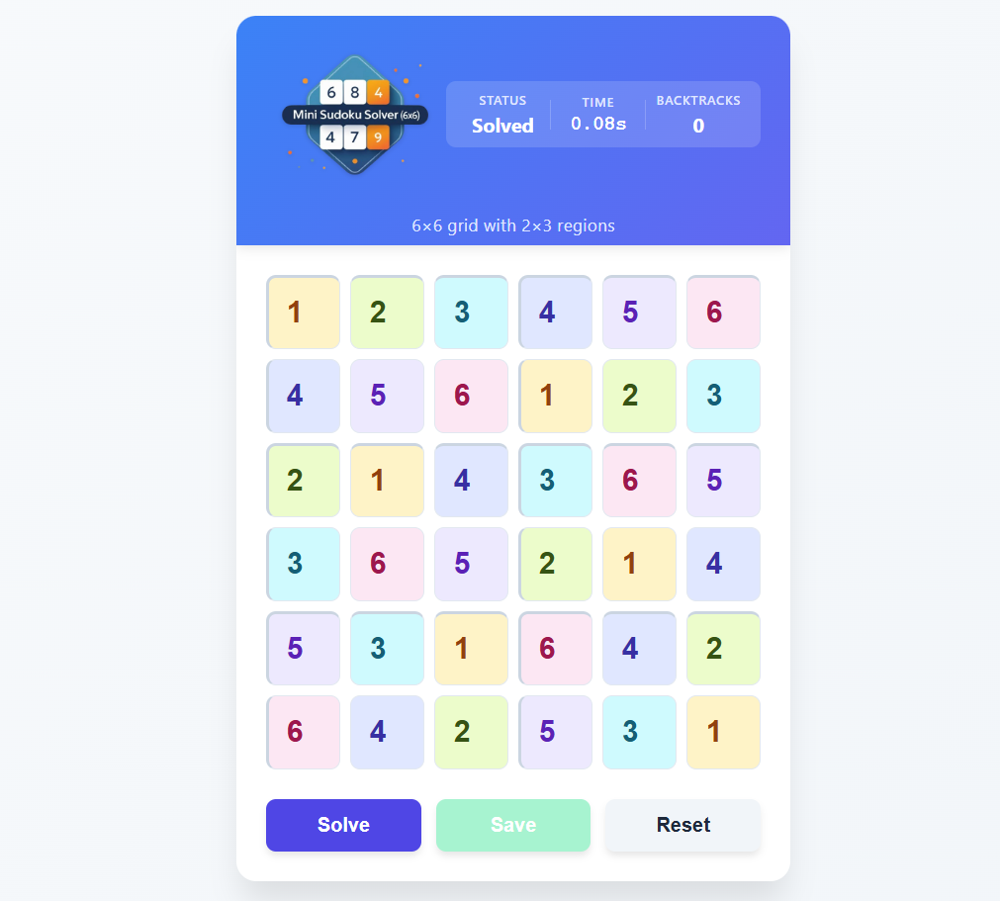
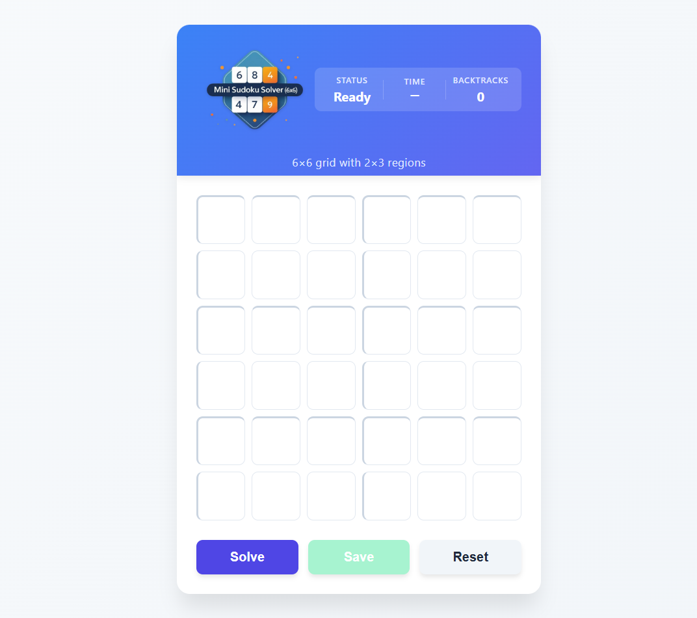
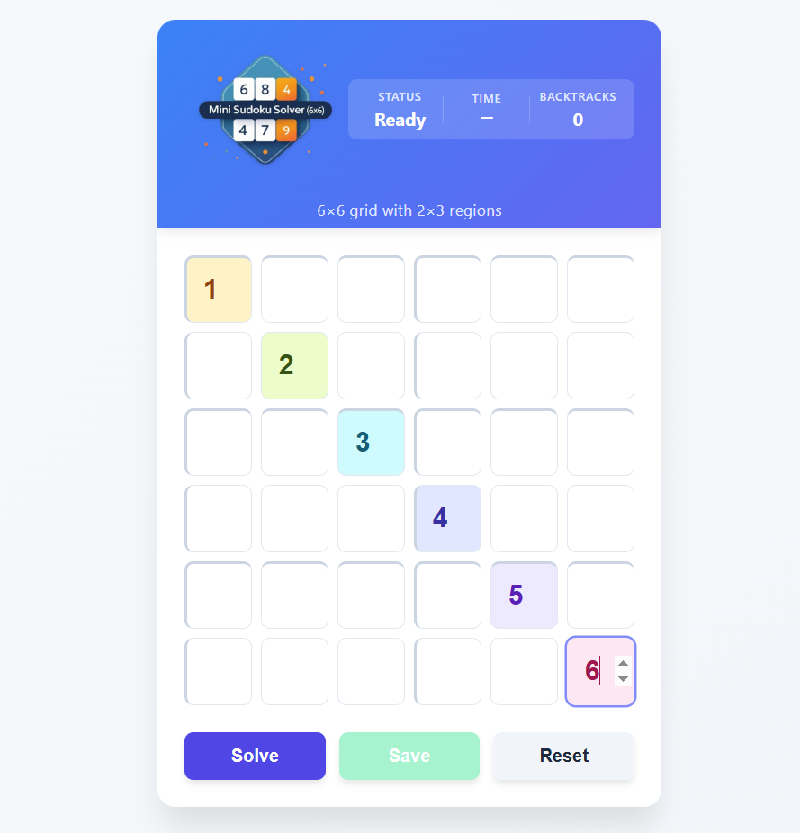
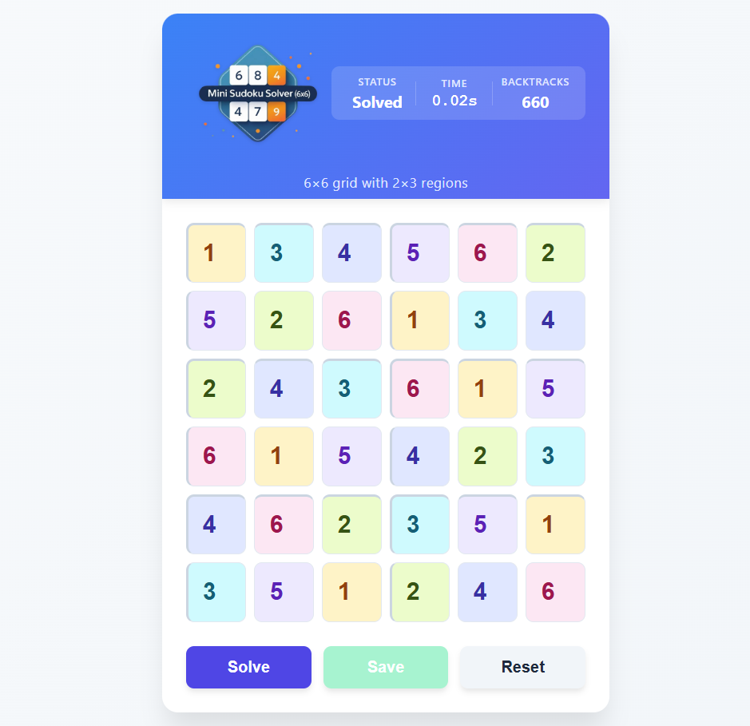

# Mini Sudoku Solver (6×6)

A lightweight React application that solves 6×6 Sudoku puzzles with 2×3 regions.

[](https://hesbon-osoro.github.io/sudoku-solver/)

## Features

- **Interactive grid**: Click any cell to enter numbers (1-6)
- **Smart validation**: Highlights conflicts in real-time
- **Quick solving**: Solves puzzles using backtracking algorithm
- **Performance stats**: Shows solve time and backtrack count
- **Responsive design**: Works on desktop and mobile

## How to Use

1. **Enter numbers** in the empty cells
2. Click **Solve** to find the solution
3. Use **Reset** to clear the board

## Development

### Prerequisites

- Node.js (v14+)
- npm/yarn

### Setup

```bash
git clone https://github.com/hesbon-osoro/sudoku-solver.git
cd sudoku-solver
yarn
yarn start
```

### Build

```bash
yarn build
```

## Technical Details

- Built with React and TypeScript
- Backtracking algorithm implementation
- Zero external dependencies (pure CSS)

## Sample

[](https://hesbon-osoro.github.io/sudoku-solver)

[](https://hesbon-osoro.github.io/sudoku-solver)

[](https://hesbon-osoro.github.io/sudoku-solver)

[](https://hesbon-osoro.github.io/sudoku-solver)
